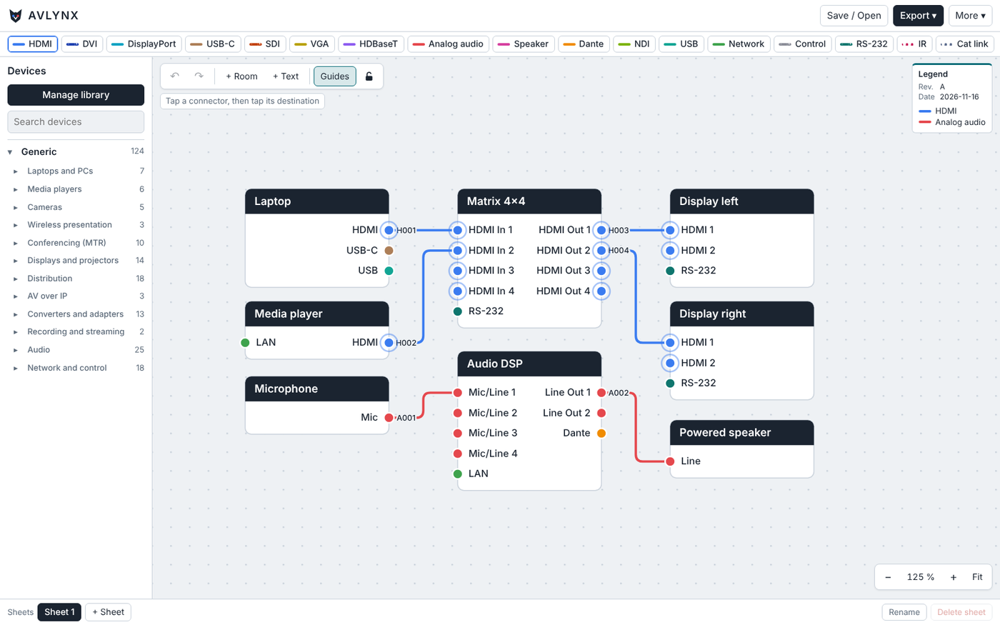

# AVLYNX

AVLYNX is a browser-based editor for AV system diagrams. Devices are placed from a library and connected by signal type; the drawing, the equipment list and the cable list are exported from the same data and always match.



## Getting started

- **Online:** https://avlynxeu.github.io/avlynx/
- **Offline:** download `avlynx.html` from the [latest release](https://github.com/avlynxeu/avlynx/releases/latest) and open it in a browser.
- **News:** follow [AVLYNX on LinkedIn](https://www.linkedin.com/company/145449744/)

AVLYNX is a single HTML file. It requires no installation, no server and no account, and it does not transmit drawings. Projects and the device library are stored in the browser.

## Features

**Drawing**
- Device blocks with any number of inputs and outputs
- 17 signal types with their own colours, including HDMI, DisplayPort, USB-C, SDI, HDBaseT, analog audio, Dante, NDI, USB, network, RS-232 and IR
- Connection check: only matching signal types connect, outputs to inputs. Different video connectors require an adapter device
- Right-angled or curved lines; every part of a right-angled line can be moved, and corners can be added
- Automatic cable IDs per signal type, for example H001 and A001
- Rooms as labelled frames; the room becomes the location of the devices inside it
- Text boxes in three highly legible fonts, alignment guides, align and distribute
- Several sheets per project, with cables that continue from one sheet to another
- Replace a device while its cables stay connected
- Details panel with the attributes of the selected device, cable or room

**Documents**
- PDF drawing with title block and legend in A1 to A4, Tabloid or Letter
- Excel workbook and CSV lists: equipment, cables and cable summary for ordering
- Cable type, length and notes for many cables in one step
- File names generated from project name, drawing number, revision and date

**Device library**
- About 120 generic devices, including adapters
- Own groups, categories and devices; import and export as JSON, Excel or CSV
- Favourites as references to library devices
- Optional shared library on a web server, with a backup before every update and a warning before changed devices are replaced

## Documentation

The [user guide](docs/AVLYNX-User-Guide.pdf) describes every function, the import format for device lists and the provision of AVLYNX to a team.

## Shared library for a team

Each user keeps a device library in the browser. To provide the same library to a team, export it under **Manage library**, rename the file to `avlynx-library.json` and place it next to `index.html` on the web server. New users receive it immediately; all other users are offered an update when the file changes. Their own devices are kept.

## Browser support

Current versions of Chrome, Edge, Safari and Firefox on desktop computers, tablets and phones. Safari requires version 15.4 or later.

## Security

- AVLYNX runs entirely in the browser. It has no server component, no account and no telemetry.
- A content security policy in the file permits connections only to the server the file was loaded from.
- Project and library files are validated when they are opened.
- The only third-party code is jsPDF 4.2.1 for the PDF export. Excel and CSV files are written and read by AVLYNX itself.
- Data in the browser is not encrypted. On shared computers, use separate browser profiles.

Please report security issues as a private security advisory on GitHub, not as a public issue.

## Build from source

The editor is developed in `src/avlynx-source.html`. To build the release file `index.html`, run:

```
python3 build/build.py
```

The build adds the content security policy and embeds jsPDF, so that the finished file works offline.

## Contributing

Suggestions and bug reports are welcome as issues. Changes to the official version are reviewed before they are merged.

## Licence

AVLYNX is released under the [MIT License](LICENSE).
Copyright (c) 2026 Timo Schönmeier.

The bundled library jsPDF and the fonts have their own licences; see [THIRD-PARTY-NOTICES.md](THIRD-PARTY-NOTICES.md).
