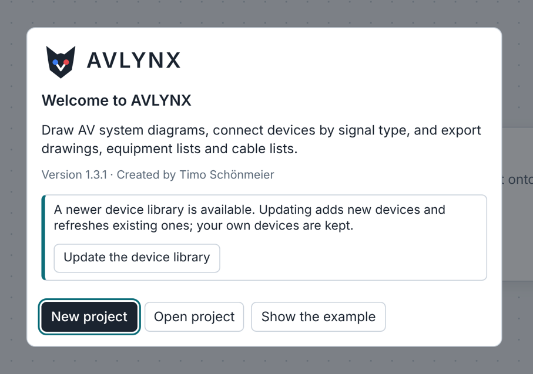
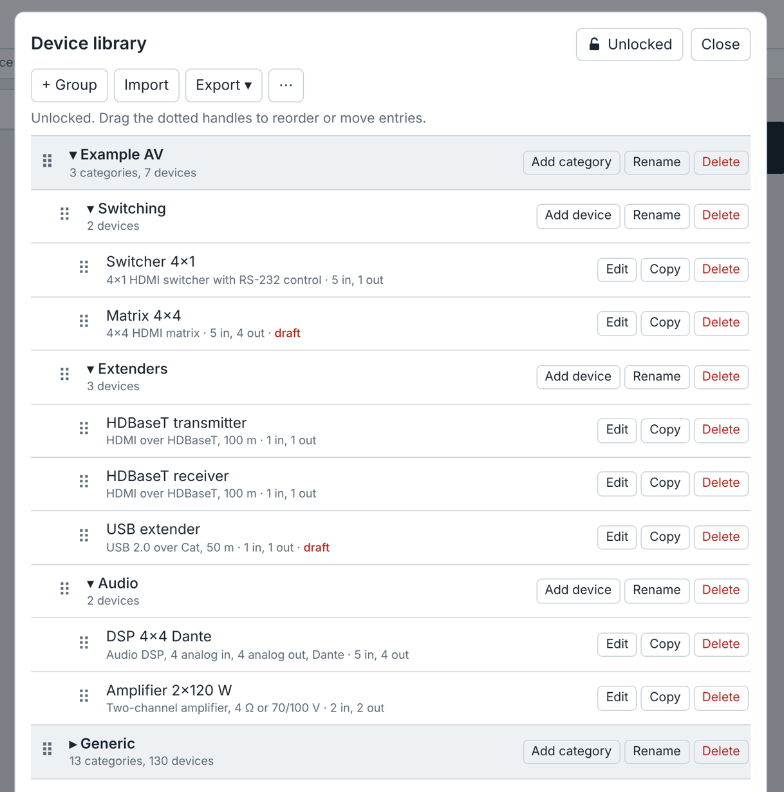
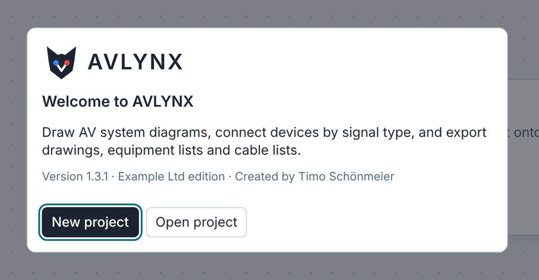

# AVLYNX administrator guide

**Hosting AVLYNX in your organisation and maintaining your own device library**

Version 1.4 · November 2026 · Also available as [PDF](AVLYNX-Administrator-Guide.pdf)

---

## Contents

1. [About this guide](#1-about-this-guide)
2. [How AVLYNX works](#2-how-avlynx-works)
3. [Choose a set-up](#3-choose-a-set-up)
4. [Requirements](#4-requirements)
5. [Hosting AVLYNX](#5-hosting-avlynx)
6. [The company device library](#6-the-company-device-library)
7. [Building a company edition](#7-building-a-company-edition)
8. [Updating AVLYNX](#8-updating-avlynx)
9. [Data, storage and backup](#9-data-storage-and-backup)
10. [Security and privacy](#10-security-and-privacy)
11. [Licence](#11-licence)
12. [Known limits](#12-known-limits)
13. [Troubleshooting](#13-troubleshooting)
14. [Roll-out checklist](#14-roll-out-checklist)
- [Appendix A: File formats](#appendix-a-file-formats)
- [Appendix B: Signal types](#appendix-b-signal-types)
- [Trademarks](#trademarks)

---

## 1 About this guide

This guide is for the person who provides AVLYNX to the colleagues in an organisation. It covers these tasks:

- placing AVLYNX on a web server in your own network;
- maintaining your own device library, for example your product range or your preferred brands;
- optionally, building a company edition with your name, colour and library built in;
- installing updates.

How to draw with AVLYNX is described in the [user guide](AVLYNX-User-Guide.pdf).

For sections 5 and 6, no programming knowledge is needed. Section 7 uses a short Python command.

---

## 2 How AVLYNX works

- **One file.** AVLYNX is a single HTML file. It contains the whole application: the PDF library jsPDF and the fonts for text boxes. Spreadsheet (.xlsx) and CSV files are written and read by AVLYNX itself.
- **No back end.** There is no database, no login and no server program. The web server only delivers static files.
- **Data stays in the browser.** Drawings, saved projects and each user's device library are stored in the browser of that user, on that device.
- **One optional library file.** If a file named `avlynx-library.json` is in the same folder as AVLYNX on the server, AVLYNX reads it. It offers this file as the company device library (section 6).
- **No outside contact.** A security policy in the file stops AVLYNX from contacting any server except the one it was loaded from.

Because each browser keeps its own data, users do not work in a shared database. Projects are exchanged as files. The company library reaches everyone through the library file on the server.

---

## 3 Choose a set-up

| | A: Release file + library file (recommended) | B: Company edition | C: Single file, no server |
| --- | --- | --- | --- |
| What you host | `index.html` from the release, and your `avlynx-library.json` | A file built with `build/company-build.py` (section 7), optionally also `avlynx-library.json` | Nothing; the file is sent to users or placed on a shared drive |
| Build step | None | One Python command per release | None, or as in B |
| Company devices | From the library file | Built in, and from the library file if present | Only if built in (B) |
| Library updates reach users | At their next start | At their next start, if the library file is present | Only with a new file |
| Same version for everyone | Yes | Yes | No |
| Company name and colour preset | No | Yes | Only if built (B) |

**Start with set-up A.** It needs no build step, and updating it means replacing two files. Choose B when AVLYNX should show your name, use your accent colour, or carry its library inside the file, for example for laptops that are often offline.

---

## 4 Requirements

| Area | Requirement |
| --- | --- |
| Server | Any web server or web space that delivers static files, preferably over HTTPS. No scripting and no database are needed. |
| Browser | A current version of Chrome, Edge or Firefox, or Safari 15.4 or newer. |
| Devices | Desktop computers, laptops and tablets. Phones work for viewing and small changes. |
| Network | Users need access to the server only. No internet access is needed. |
| Build (set-up B only) | Python 3.8 or newer. No extra packages are needed. |

---

## 5 Hosting AVLYNX

### 5.1 Steps

1. Download `avlynx.html` from the [latest release](https://github.com/avlynxeu/avlynx/releases/latest), or use your own company edition from section 7.
2. On the web server, create a folder, for example `/avlynx/`.
3. Copy the file into the folder and rename it to `index.html`.
4. Optional: copy your library file into the same folder as `avlynx-library.json` (section 6). The name must be exactly this.
5. Open the address in a browser, for example `https://intranet.example.com/avlynx/`. The welcome message appears.
6. Choose **New project**. If you added a library file, its groups are in the device list.
7. Give the address to your users.

> **Keep the address.** The browser ties stored projects and libraries to the address (protocol, host name and port). If AVLYNX moves to another address, every user starts with an empty browser storage there. They can only get their work back from saved project and library files.

### 5.2 Recommended server settings

- Deliver the folder over **HTTPS**.
- Prevent long caching of `index.html`, for example with `Cache-Control: no-cache`, so that a new version reaches users at once. AVLYNX always fetches the library file fresh.
- Deliver `.json` files as `application/json`.
- Optional hardening:
  - `X-Content-Type-Options: nosniff`
  - `Content-Security-Policy: frame-ancestors 'self'`. This stops other websites from embedding the page.
- Restrict access if only your staff may use AVLYNX (section 5.4).

The library file must be on the **same server and address** as `index.html`. AVLYNX is not allowed to read files from other servers, file shares or content delivery networks.

### 5.3 Examples

Each example serves a folder that contains `index.html` and, optionally, `avlynx-library.json`.

#### Linux with nginx

```bash
sudo apt update && sudo apt install nginx
sudo mkdir /var/www/html/avlynx
sudo cp index.html avlynx-library.json /var/www/html/avlynx/
```

Add the following inside the `server` block of `/etc/nginx/sites-available/default`:

```nginx
location /avlynx/ {
    add_header Cache-Control "no-cache";
    add_header X-Content-Type-Options "nosniff";
    add_header Content-Security-Policy "frame-ancestors 'self'";
}
```

```bash
sudo nginx -t && sudo systemctl reload nginx
```

#### Apache

Copy the files into a folder below the document root, for example `/var/www/html/avlynx/`. Add a file `.htaccess` in that folder. It needs `mod_headers` and `AllowOverride FileInfo`.

```apache
<IfModule mod_headers.c>
    Header set Cache-Control "no-cache"
    Header set X-Content-Type-Options "nosniff"
    Header set Content-Security-Policy "frame-ancestors 'self'"
</IfModule>
AddType application/json .json
```

#### Windows Server with IIS

1. In Server Manager, add the role **Web Server (IIS)**. The default website serves `C:\inetpub\wwwroot`.
2. Create `C:\inetpub\wwwroot\avlynx` and copy the files into it.
3. In the same folder, create `web.config`:

```xml
<?xml version="1.0" encoding="UTF-8"?>
<configuration>
  <system.webServer>
    <staticContent>
      <remove fileExtension=".json" />
      <mimeMap fileExtension=".json" mimeType="application/json" />
      <clientCache cacheControlMode="DisableCache" />
    </staticContent>
    <httpProtocol>
      <customHeaders>
        <add name="X-Content-Type-Options" value="nosniff" />
        <add name="Content-Security-Policy" value="frame-ancestors 'self'" />
      </customHeaders>
    </httpProtocol>
  </system.webServer>
</configuration>
```

4. For HTTPS, bind a certificate to the website in IIS Manager under **Sites › Default Web Site › Bindings**.

#### Docker

```bash
docker run -d --name avlynx --restart unless-stopped -p 8080:80 \
  -v "$PWD":/usr/share/nginx/html:ro nginx:alpine
```

Run this command in the folder that holds the files, then open `http://<server>:8080/`. Put the container behind your existing reverse proxy for HTTPS and sign-in.

#### NAS (for example Synology)

Install **Web Station**, create the folder `web/avlynx` and upload the files. Open `http://<address of the NAS>/avlynx/`. Make the NAS reachable from the company network only, unless HTTPS and access control are set up.

#### Quick test with Python

```bash
python3 -m http.server 8000
```

Run this in the folder that holds the files. Colleagues in the same network open `http://<IP address>:8000`. Use this for tests only.

#### Not suitable

Document libraries such as SharePoint or OneDrive, and most file-sync services, offer an HTML file for download instead of opening it as a page. Use a web server, or set-up C.

### 5.4 Access control

AVLYNX has no login of its own. To restrict it to your staff, use what your organisation already has:

- the company network or VPN only;
- sign-in at the web server or reverse proxy, for example with single sign-on;
- an access gateway such as Microsoft Entra application proxy or Cloudflare Access.

The public edition contains no company data and can be reachable by anyone. A company edition or library file with information that must stay private should always be behind access control.

### 5.5 As an app on the device

- **Edge and Chrome:** open the address, then install the page as an app from the browser menu. It gets its own icon and window.
- **iPad and iPhone:** in Safari, tap **Share**, then **Add to Home Screen**.
- **Android:** in Chrome, use **Add to Home screen** or **Install app** from the menu.

### 5.6 Check the installation

- The welcome message appears and shows the expected version.
- With a library file, the device list contains your groups. In the developer tools of the browser (F12, **Network** tab), `avlynx-library.json` is loaded with status 200.
- **Save as file**, the PDF export and the spreadsheet export each start a download.

---

## 6 The company device library

### 6.1 How it reaches the users

Each user has a device library in the browser. It starts with the devices built into the file, which are about 130 generic devices, plus a company library if one is built in. The library file on the server keeps it current:

- A user who opens AVLYNX for the first time receives the server library automatically.
- For everyone else, AVLYNX compares the server file with the user's library at every start. If the server file is newer, the welcome message and **Manage library** offer the update.



*Figure 1: A user is offered a newer device library at start*

### 6.2 What an update does

| Situation | Result |
| --- | --- |
| Device is new in the company library | It is added to its group and category. Missing groups and categories are created. |
| Device exists with the same model in a company group | It is replaced by the company version and moved to the group and category it has there. If the user had changed it, AVLYNX warns first. |
| Device was added by the user | It stays. |
| Device was removed from the company library | It is removed only if the library file lists its model under `retired` (Appendix A). Otherwise it stays in the users' libraries. |
| User clicks **Reset to defaults** | The library returns to the devices built into the file. If the server library is newer, it is offered again at the next start. |

AVLYNX matches devices by model. A device without a model is matched by its name. Keep each model unique across all company groups.

An update removes groups and categories that it leaves empty. It does not change the generic devices or the users' own groups.

**Protection of the users' own work**

- Before every update, AVLYNX keeps a backup of the user's whole library in the browser.
- A warning lists the company devices that the user has changed and that the update would replace or remove. The user can cancel, copy those devices into a group of their own, and update afterwards.
- After the update, **Undo** in the welcome message or **Undo library update** in the ⋯ menu of **Manage library** restores the previous library.

Ask users to keep their own devices in a group of their own, for example "My devices". If they want to change a company device, they should copy it first. Then an update never touches their work.

### 6.3 Maintaining the library

One person should maintain the company library. A small example library to start from is in [`docs/example-library.json`](example-library.json).

1. Open AVLYNX and choose **Manage library**.
2. Click the lock button to unlock the library. It locks again when the window closes.
3. Add, edit, copy, move or delete devices, categories and groups. To start from the example, choose **Import** and select `example-library.json`.
4. Choose **Export ▾**, then **Export as JSON**. The file name contains the date and time, for example `AVLYNX-library_2026-11-26_1342.json`. Keep this file as your backup.
5. Make a copy, rename the copy to `avlynx-library.json` and replace the file on the server.

The two different names prevent a user's own export from replacing the company file by mistake.



*Figure 2: The library manager, unlocked*

Every export records the time it was made, as `stamp`. AVLYNX uses it to decide whether the server file is newer than a user's library. If a file has no `stamp`, the modification date of the file on the server is used.

**Do I need to keep the generic devices in the file?** No. The server file only needs your own groups. The generic devices are built into AVLYNX and are never changed by an update.

### 6.4 Editing many devices in a spreadsheet

1. In **Manage library**, choose **Export ▾**, then **Export as spreadsheet (.xlsx)**.
2. Edit the list in a spreadsheet program. Add rows for new devices.
3. In AVLYNX, choose **Import** and select the .xlsx file.
4. Check the result, then export as JSON (section 6.3) and replace the file on the server.

| Column | Content |
| --- | --- |
| Group | Name of the group, for example the brand. Created if it does not exist. |
| Category | Name of the category. Created if it does not exist. |
| Name | Device name as shown on the block. If empty, the model is used. |
| Manufacturer, Model, Description | Used in the equipment list and in the device list. |
| Status | `draft` or `verified`. Devices without connectors are marked as not yet defined. |
| Inputs, Outputs | Connectors as `Label:type`, separated by semicolons, for example `HDMI In 1:hdmi; LAN:lan`. The types are listed in Appendix B. |
| Loop | `yes` if an output of the device may be connected to one of its own inputs, for example on a matrix. |

An import updates a device with the same model in the same group and leaves it in its current category. To move a device to another category, drag it in **Manage library**.

### 6.5 Conventions that keep the library tidy

- Use one group per brand, and add **Generic** devices only when the built-in ones are not enough.
- Use the exact article number as the model. For a kit, create one block per unit and add "(TX)" or "(RX)" to the model.
- Use `aliases` (Appendix A) for old and new article numbers of the same device. The search finds the device by every alias.
- Mark devices as `draft` until their connectors have been checked against the datasheet, then as `verified`.
- When a product is discontinued, delete it and add its model to `retired`, so that it also leaves the users' libraries.

---

## 7 Building a company edition

A company edition is the release file with up to five settings filled in. The script `build/company-build.py` does this without changing anything else in the file.



*Figure 3: The welcome message names the edition next to the version*

### 7.1 Build

1. Download the repository, or at least `index.html` and the folder `build`, from the release you want to use.
2. Export your library as JSON (section 6.3).
3. Run:

```bash
python3 build/company-build.py \
  --output avlynx-example.html \
  --edition "Example Ltd edition" \
  --company "Example Ltd" \
  --library avlynx-library.json \
  --accent "#2b4c9a"
```

The script prints the SHA-256 checksum of the new file and what it set:

```
avlynx-example.html 3f2a…
  edition: Example Ltd edition
  company: Example Ltd
  library: 1 groups, 6 devices
  accent: #2b4c9a
```

4. Open the new file in a browser. The welcome message shows the edition, and the library contains your groups.
5. Host it as `index.html` (section 5). You can also keep `avlynx-library.json` next to it: users then get library changes without a new build.

### 7.2 Options

| Option | Effect |
| --- | --- |
| `--input` | The release file to start from. Default: `index.html` of the repository. `avlynx.html` from a release works too. |
| `--output` | The file to write. Default: `avlynx-company.html`. |
| `--edition` | Text next to the version in the welcome message, up to 60 characters. |
| `--company` | Company name filled in on the title block of new projects, up to 120 characters. |
| `--library` | A library file exported from AVLYNX. Its groups are built into the file. |
| `--accent` | Accent colour for new projects, the legend and the PDF, as `#rrggbb`. |
| `--hide` | Parts of the interface to hide, separated by commas: `libraryManager`, `example`, `customDevice`. |

Every option is optional. The script refuses files that are not release files, colours that are not `#rrggbb`, and unknown parts. Texts are stored so that they are always shown as plain text.

**Hidden is not protected.** A part switched off with `--hide` is not shown, but the data and the code stay in the file. Anything that must stay private, such as prices or an unpublished product list, does not belong in AVLYNX at all.

For add-ons that read the drawing, insert ready-made rooms, add buttons or check cables, see [EXTENSIONS.md](EXTENSIONS.md).

### 7.3 After each new release

Repeat the build with the new release file and the same options. Keep the command in a small script next to your library backups, so that every update builds the same way.

---

## 8 Updating AVLYNX

1. Watch the repository on GitHub (**Watch › Custom › Releases**) to be notified of new releases. The changes are listed in [CHANGELOG.md](../CHANGELOG.md).
2. Download the new `avlynx.html` and check its checksum (see below). For set-up B, build the company edition again (section 7.3).
3. Keep a copy of the current `index.html`.
4. Replace `index.html` on the server with the new file.
5. Open the address and check the version in the welcome message.

- The users' projects and libraries stay, because the address stays the same.
- Users who have AVLYNX open get the new version when they reload the page.
- To go back, put the previous file in place again.

**Checksums.** The release lists the SHA-256 checksum of the file in `SHA256SUMS.txt`. Calculate the checksum of the downloaded file and compare:

- Windows: `certutil -hashfile avlynx.html SHA256`
- macOS and Linux: `shasum -a 256 avlynx.html`

A company edition has a different checksum. Note the one that `company-build.py` prints.

---

## 9 Data, storage and backup

| Data | Where it is | How to back it up |
| --- | --- | --- |
| Current drawing with all sheets | Browser storage of the user | **Projects**, then **Save as file** |
| Saved projects | Browser storage of the user | **Projects**, then **Save as file** |
| Device library of the user | Browser storage of the user | **Manage library**, then **Export ▾**, **Export as JSON** |
| Company device library | `avlynx-library.json` on the server | Your exported library files |
| Application | `index.html` on the server | Copy of the file |

Browser storage is lost in these cases:

- the user clears the browsing data;
- the user works in a private window;
- the user changes browser or device;
- the address of AVLYNX changes.

Ask users to save important projects as files in the usual project folders.

Browser storage is limited, typically to about 5 MB per address. When it is full, AVLYNX says so and asks the user to save the project as a file. Large logos are the usual cause.

For support: AVLYNX uses these browser storage keys:

| Key | Content |
| --- | --- |
| `avplan.proto.v1` | Current drawing, library and settings |
| `avlynx.projects.v1` | Saved projects |
| `avlynx.libbackup.v1` | The library before the last update |
| `avlynx.clip.v1` | Objects last copied with Ctrl+C |
| `avlynx.ports.v1` | Connectors last copied in the device editor |

---

## 10 Security and privacy

### 10.1 What AVLYNX does and does not do

- **No data leaves the device.** AVLYNX does not transmit drawings, project details, logos or libraries. There is no telemetry and no account.
- **Outside contact is blocked.** A Content Security Policy in the file allows connections only to the server the file came from. There, AVLYNX reads nothing but the optional library file.
- **Imported files are checked.** Project and library files are validated when they are opened, and files larger than 20 MB are refused. Text from files is always shown as plain text. Colours and logos cannot load anything from other servers.
- **Lists are safe to open.** In spreadsheet (.xlsx) files, text is stored as text. In CSV files, cells that a spreadsheet program would run as a formula are neutralised.
- **No code is generated at run time.** AVLYNX does not turn text into program code.
- **Fonts are built in.** No font is loaded from the internet.

### 10.2 Components

| Component | Licence | Remarks |
| --- | --- | --- |
| AVLYNX | MIT | The editor itself |
| jsPDF 4.2.1 | MIT | PDF export. The copy in the file is identical to the npm package. |
| Atkinson Hyperlegible, Atkinson Hyperlegible Mono | SIL Open Font License 1.1 | Fonts for text boxes. They contain no program code. |

The licence texts are in the folder [`licenses`](../licenses) and in [THIRD-PARTY-NOTICES.md](../THIRD-PARTY-NOTICES.md).

### 10.3 What you are responsible for

- **Access control.** Restrict who can open the address with the means of your server or network (section 5.4).
- **The locks are not access control.** The library lock and the drawing lock prevent accidental changes. Anyone who can open AVLYNX can unlock them.
- **Write access to the server folder.** Every user's browser fully trusts `index.html` and `avlynx-library.json`. Only the administrator and the library maintainer should be able to replace them.
- **HTTPS.** HTTPS prevents the files from being changed on the way to the browser.
- **Shared computers.** Browser storage is not encrypted. People who share a browser profile see each other's projects, including customer names. Use separate user accounts or browser profiles.

### 10.4 Reporting a vulnerability

Report security issues as a private security advisory in the GitHub repository (**Security › Report a vulnerability**), not as a public issue.

---

## 11 Licence

AVLYNX is published under the MIT licence. You may host it, use it commercially, build company editions and change the source. Keep the copyright and licence notice in every copy, including company editions. The bundled jsPDF and fonts keep their own licences (section 10.2).

---

## 12 Known limits

- There is no live shared database and no synchronisation between devices. Projects are shared as files, and the library is shared through the server file.
- A cable to another sheet is shown as a tag at each end, not as a line.
- Automatic cable IDs are renumbered when a cable is deleted. To keep a cable ID fixed, enter it by hand.
- The PDF supports Western European characters; others are replaced.
- Favourites, like the user's library, are stored per browser and are not shared.
- **Export as JSON** does not write the `retired` list. Add it by hand to the server file (Appendix A).

---

## 13 Troubleshooting

| Problem | Cause and remedy |
| --- | --- |
| The company devices are missing | The library file is not next to `index.html`, has another name, or AVLYNX was opened as a file instead of from the server. Open `https://<address>/avlynx-library.json` in a browser to check. |
| Users are not offered a library update | The server file is not newer than their library. Export the library again and replace the file; check that the server delivers the new file and not a cached copy. |
| A user still sees the old version | The browser has cached the page. Reload it; set the server not to cache `index.html` (section 5.2). |
| The page downloads instead of opening | The server delivers HTML with a wrong content type, typically on document libraries such as SharePoint. Use a web server (section 5.3). |
| A user's projects are gone | The browsing data was cleared, or another browser, device or address is in use. Open the project file from the backup. |
| "The browser cannot store your changes" | The browser storage is full or blocked, often in a private window or because of a large logo. Save the project as a file and use a normal window. |
| The page shows only a sentence about the browser | The browser is too old. Update it; Safari must be 15.4 or newer. |
| An import reports an unknown signal type | A connector uses a type that does not exist. Use the short names from Appendix B. |
| `company-build.py` reports "placeholder not found" | The input is not an unchanged release file, or it is older than version 1.2. Use `index.html` or `avlynx.html` from a current release. |
| Export does nothing | The drawing contains no device, or the browser blocks downloads for this address. Allow downloads and check the download list. |

---

## 14 Roll-out checklist

- [ ] The address is final and delivered over HTTPS.
- [ ] Access is restricted as needed (section 5.4).
- [ ] `index.html` and `avlynx-library.json` are in the same folder.
- [ ] A first start in a fresh browser shows your device groups.
- [ ] AVLYNX was tried on every kind of device in use, including Safari on an iPad if you use iPads.
- [ ] PDF, spreadsheet and project file were exported once on each kind of device.
- [ ] The library maintainer and the place for library backups are named.
- [ ] Users know: save projects as files, and keep their own devices in a group of their own.
- [ ] A copy of the delivered files, their checksums and, for set-up B, the build command are stored.

---

## Appendix A: File formats

Both file types are plain JSON text in UTF-8.

### Library file

```json
{
  "app": "AVLYNX", "type": "library", "version": 1,
  "stamp": 1795600000000,
  "groups": [
    { "name": "Example AV", "cats": [
      { "name": "Switching", "devs": [
        { "name": "Switcher 4×1", "mfr": "Example AV", "model": "EX-SW41",
          "desc": "4×1 HDMI switcher", "status": "verified",
          "ports": [
            { "name": "HDMI In 1", "dir": "in",  "type": "hdmi" },
            { "name": "HDMI Out",  "dir": "out", "type": "hdmi" } ] }
      ] }
    ] }
  ],
  "retired": [ "EX-OLD-1" ]
}
```

| Field | Meaning |
| --- | --- |
| `stamp` | Time of the export in milliseconds since 1970. A larger value means a newer library. |
| `groups` › `cats` › `devs` | Groups, their categories and the devices in them. |
| `name` | Device name on the block. |
| `mfr`, `model`, `desc` | Manufacturer, model and description. Optional, but `model` should be set for company devices (section 6.2). |
| `status` | `draft` or `verified`. Optional. |
| `loop` | `true` if an output may be connected to one of the device's own inputs. Optional. |
| `aliases` | Other model numbers of the same device, for example old and new article numbers. Optional. |
| `ports` | Connectors with `name`, `dir` (`in` or `out`) and `type` (Appendix B). Up to 256 per device. |
| `retired` | Models (or names, for devices without a model) to remove from the users' libraries. Optional. |

### Project file

```json
{ "app": "AVLYNX", "type": "project", "version": 2, "cur": 0,
  "doc": { "project": "…", "customer": "…", "page": "a3", "orient": "landscape" },
  "sheets": [ { "id": "s1", "name": "Sheet 1",
                "nodes": [], "edges": [], "zones": [], "texts": [] } ] }
```

`nodes` are the devices, `edges` the connections, `zones` the rooms and `texts` the text boxes of a sheet. A sheet can have its own `orient`. Project files from earlier versions are still opened.

---

## Appendix B: Signal types

| Signal type | Short name | Cable ID | Connection rule |
| --- | --- | --- | --- |
| HDMI | `hdmi` | H | Output to input |
| DVI | `dvi` | DV | Output to input |
| DisplayPort | `dp` | DP | Output to input |
| SDI | `sdi` | SDI | Output to input |
| USB-C | `usbc` | UC | Output to input |
| VGA | `vga` | V | Output to input |
| HDBaseT | `hdbt` | HB | Output to input |
| Analog audio | `audio` | A | Output to input |
| Speaker | `spk` | SP | Output to input |
| Cat link (proprietary) | `cat` | CL | Output to input |
| Dante | `dante` | D | Any two connectors |
| NDI | `ndi` | NDI | Any two connectors |
| USB | `usb` | U | Any two connectors |
| Network | `lan` | N | Any two connectors |
| Control | `ctrl` | C | Any two connectors |
| RS-232 | `rs232` | RS | Any two connectors |
| IR | `ir` | IR | Any two connectors |
| Fiber (SFP) | `fiber` | F | Any two connectors |
| Power | `power` | PW | Output to input |

Some related types connect to each other:

- Dante and NDI connect to Network, so network switches need no dedicated ports.
- USB-C connects to USB for USB data.

Such a line counts as the more specific signal (Dante, NDI or USB).

All other connections need the same signal type on both ends:

- Different video connectors, for example USB-C and HDMI, need an adapter device in between.
- Fiber (SFP) connects only to fiber. Whether a link is multimode or single mode is recorded as the cable type.

Each connector takes one cable, with these exceptions:

- Analog audio connectors take up to two.
- Speaker connectors take any number, including speaker-to-speaker chains for 70/100 V systems.

---

## Trademarks

draw.io is a trademark of draw.io Ltd. Microsoft and Excel are trademarks of the Microsoft group of companies. HDMI is a trademark of HDMI Licensing Administrator, Inc. HDBaseT is a trademark of the HDBaseT Alliance. Dante is a trademark of Audinate Pty Ltd. DisplayPort is a trademark of VESA. NDI is a trademark of Vizrt NDI AB. USB-C is a trademark of USB Implementers Forum. Other names of products, interfaces and file formats are trademarks of their owners. They are used only to describe compatibility; AVLYNX is not affiliated with or endorsed by these companies.
